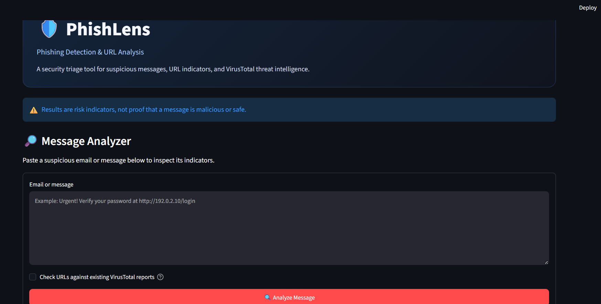
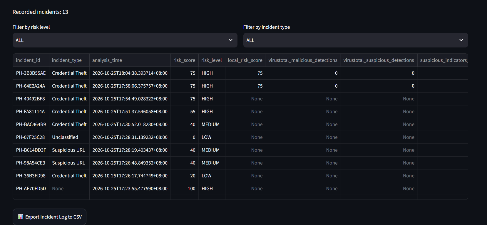
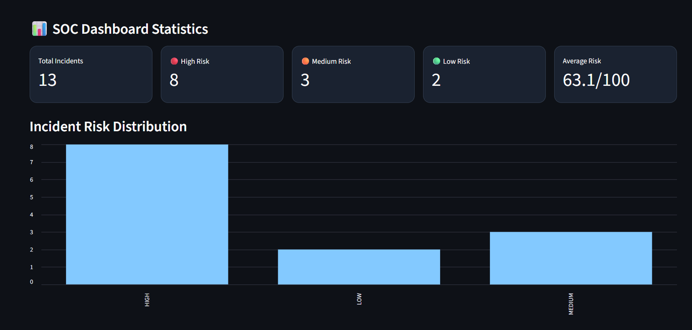

# PhishLens 🔐

### Rule-Based Phishing Detection & SOC Triage Tool

PhishLens is a Python-based security tool designed to assess suspicious messages and URLs using rule-based risk scoring and optional VirusTotal integration. It provides risk classifications and investigation features to support basic Security Operations Center (SOC) triage workflows.

## Features

- **Phishing Risk Assessment:** Evaluates suspicious messages using predefined indicators.
- **URL Analysis:** Identifies potentially suspicious URL patterns.
- **Risk Classification:** Categorizes findings into Low, Medium, and High risk levels.
- **VirusTotal Integration:** Optionally checks existing URL scan reports.
- **Incident Logging:** Records analysis results for investigation and review.
- **JSON Reports:** Downloads analysis results as JSON.
- **CSV Export:** Exports incident history for further analysis.
- **SOC Dashboard:** Displays incident statistics and supports basic filtering.

## Technology Stack

- Python
- Streamlit
- Requests
- Python-dotenv
- VirusTotal API

## Getting Started

### 1. Clone the repository

```bash
git clone https://github.com/reemi01/PhishLens-..git
cd PhishLens
```

### 2. Install dependencies

```bash
pip install -r requirements.txt
```

### 3. Configure the environment

Create a `.env` file in the project directory and add your VirusTotal API key:

```env
VT_API_KEY=your_api_key_here
```

The API integration is optional. Keep your API key private and never commit your `.env` file.

### 4. Run the application

```bash
python -m streamlit run app.py
```

## Risk Assessment

PhishLens combines message indicators and URL warnings into a risk score from 0 to 100. The result is classified as Low, Medium, or High risk. Optional VirusTotal results can increase the final risk level.

## Project Structure

```text
PhishLens/
├── app.py
├── risk_engine.py
├── test_phishlens.py
├── requirements.txt
├── SOC_Analysis_Report.md
├── screenshots/
│   ├── main-interface.png
│   ├── analysis-results.png
│   └── soc-dashboard.png
└── .gitignore
```

## Testing

Run the automated tests with:

```bash
python -m pytest -v
```

## Limitations

PhishLens is a rule-based screening and triage tool. Its results are indicative and should not be treated as definitive proof that a message or URL is safe or malicious. URL patterns and third-party scan results may not detect every threat.

## Future Improvements

- Expand phishing detection rules.
- Add more comprehensive automated tests.
- Improve incident prioritization and reporting.
- Integrate additional threat intelligence sources.

## Disclaimer

This project is intended for educational and defensive cybersecurity purposes. Always verify suspicious content before taking action.

## Author

**Reem Bekdash**

[GitHub Profile](https://github.com/reemi01)

## Screenshots

### Main Interface



### Analysis Results



### SOC Dashboard

